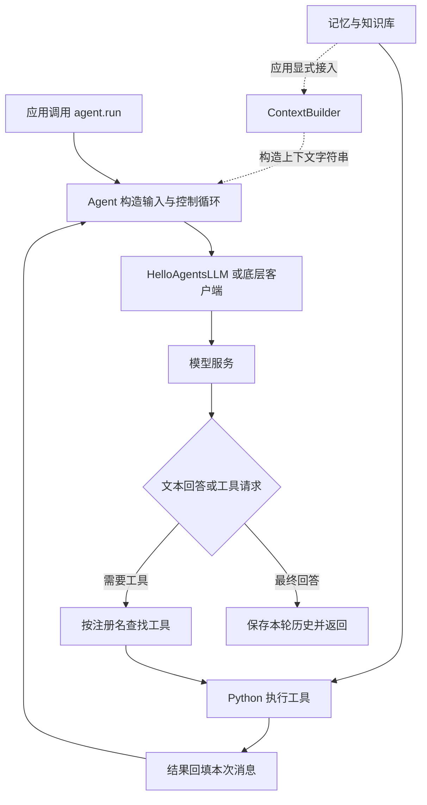

# HelloAgents 深入学习：从一次请求读懂框架

本文针对本仓库源码版本 **0.2.9**，以 `fd10e99` 为学习分支的起点，核对日期为 2026-11-11。源码中的中文学习注释和本文说明的是这一检出的实际行为，不把 README 的能力介绍当作全部功能已经验证的证据。

适合已有 Python 基础、第一次系统阅读 Agent 框架的读者。建议先读根目录的 [源码学习指南](../../源码学习指南.md)，再按本文逐层调试。所有源码链接均相对当前文档，可在 GitHub 上打开。

## 1. 先理解这个项目解决什么问题

假设用户问：“根据我的资料解释 RAG，再计算一个表达式。”一次直接模型调用只能根据输入生成文本。要让模型读取资料、使用计算器、记住用户信息，需要程序在模型调用外面建立循环：组织输入 → 获取模型输出 → 判断是否需要工具 → 真正执行工具 → 把结果交回模型。

HelloAgents 把这几个责任拆开：

| 组件 | 负责什么 | 不会自动完成什么 |
| --- | --- | --- |
| `HelloAgentsLLM` | 将消息发送到兼容接口，提取模型结果 | 不会自行执行模型提出的工具调用 |
| `Agent` 及子类 | 决定消息组织、迭代方式、停止条件 | 不保证达到上限时任务已经成功 |
| `Tool` / `ToolRegistry` | 描述能力、按名称找到实际 Python 实现并执行 | 参数 schema 不等于业务校验或授权 |
| `MemoryManager` | 分派不同记忆类型的读写与检索 | 保存后不会自动进入下一次模型输入 |
| RAG pipeline | 加载、分块、嵌入、索引、检索资料 | 单独检索不会自动生成回答 |
| `ContextBuilder` | 把候选信息选入有限上下文预算 | 不会自动接管所有 Agent 的输入 |
| evaluation | 组织样本、调用 Agent、解析预测、评分 | 模型评审不等于客观正确性证明 |
| rl | 包装训练数据、奖励和 trainer | 普通对话、写记忆不会更新权重 |

**模型负责提出回答、动作或计划；程序负责控制循环、解析、查找、执行、存储和停止。** 模型说“查到了”与程序实际取得搜索结果是两件事。



图中上下文构建是应用的可选组合，核心 Agent 不会默认调用 `ContextBuilder.build()`。

## 2. 目录地图与推荐顺序

| 路径 | 内容 | 学习重点 |
| --- | --- | --- |
| [`hello_agents/__init__.py`](../../hello_agents/__init__.py) | 顶层导出 | `from hello_agents import ...` 如何找到类 |
| [`core/`](../../hello_agents/core) | 消息、基类、LLM、配置、异常 | 公共契约与运行环境 |
| [`agents/`](../../hello_agents/agents) | 六种 Agent 实现 | 对比不同 `run` 方法 |
| [`tools/`](../../hello_agents/tools) | 工具基类、注册、链式与异步调用 | 参数和返回值如何跨边界 |
| [`tools/builtin/`](../../hello_agents/tools/builtin) | 搜索、计算、笔记、终端、记忆、RAG 等 | `run(parameters)` 的 action 分发 |
| [`memory/`](../../hello_agents/memory) | 记忆类型、嵌入与后端 | 写入、检索和持久化生命周期 |
| [`context/`](../../hello_agents/context) | GSSC 上下文流水线 | 相关性、预算和信息丢失 |
| [`protocols/`](../../hello_agents/protocols) | MCP / A2A / ANP 适配 | 组件边界与实际通信实现 |
| [`evaluation/`](../../hello_agents/evaluation) | BFCL、GAIA、LLM Judge、胜率 | 数据、预测解析、评分依据 |
| [`rl/`](../../hello_agents/rl) | 数据集、奖励、训练包装 | 哪一步真正更新模型参数 |
| [`examples/`](../../examples) | 按章节组织的示例 | 从使用方法回到源码 |
| [`tests/`](../../tests) | 本地离线与显式开启的真实模型测试 | 测试能证明什么 |

推荐顺序：Message → Agent → LLM → SimpleAgent → ToolRegistry → FunctionCallAgent → ReAct → Reflection / PlanAndSolve → Memory / RAG → Context → 协议 / 评估 / 训练。

## 3. 环境先行：确保运行的就是正在看的源码

在项目根目录执行以下只读检查：

```bash
.venv/bin/python -c "import sys, hello_agents; print(sys.executable); print(hello_agents.__file__); print(hello_agents.__version__)"
```

解释器、模块文件位置和版本应一起检查。同名已安装包可能与本地仓库不同。PyCharm 的运行配置还要核对工作目录、所选解释器和环境变量。

本次本地 `.venv` 实际为 Python 3.9.6，且缺少导入链需要的 huggingface_hub，因此直接运行测试会在收集阶段失败。已使用现有 `/opt/anaconda3/envs/atguigu_ai/bin/python`（Python 3.10.0）完成验证，没有修改原 `.venv`。下文 `.venv/bin/python` 命令要求先选用满足依赖的环境；在本机可替换为上述已验证解释器。

本地项目要求 Python >= 3.10。基础依赖和可选依赖见 [`pyproject.toml`](../../pyproject.toml)：`search`、`memory`、`rag`、`protocols`、`evaluation`、`rl` 按任务选择。不要为了学习一次普通对话直接启动全部数据库或训练环境。

如果需要新建环境，可按所选环境的 Python 执行 `python -m pip install -e .`，再按需安装额外依赖。BFCL 官方工具与本项目 NumPy 要求的冲突已写在依赖文件中，应使用独立环境；本文没有安装或运行它。

### 3.1 配置从哪里来

[`core/llm.py`](../../hello_agents/core/llm.py) 的初始化顺序：

1. `model` 优先使用显式参数，否则读取 `LLM_MODEL_ID`。
2. 未指定 provider 时，先查服务商专用环境变量，再检查密钥特征和地址，最后回退 `auto`。
3. `_resolve_credentials()` 按 provider 选择显式参数、专用环境变量、统一 `LLM_*` 变量或默认地址。
4. 缺少 model 时选择默认值；缺少 key 或地址时抛异常。
5. `_create_client()` 创建客户端；真正模型请求发生在调用接口时。

因此多个服务商环境变量同时存在时，自动识别结果可能偏离你的意图。显式指定 provider 更易排查。`provider="custom"` 分支直接使用传入或统一配置的 key 与地址。

`HelloAgentsLLM` 本文件没有调用 `load_dotenv()`；`.env` 是否加载要看应用入口。例如真实模型测试显式按项目路径加载。只创建 `.env` 文件不等于每一种启动方式都会读取。

`Config` 和 `HelloAgentsLLM` 是两个对象：`Agent` 保存 `config`，不代表 `Config.temperature` 自动覆盖 `llm.temperature`。`max_history_length` 也没有在基类 `add_message()` 中被执行为裁剪规则。

## 4. 核心数据：三种“历史”不要混淆

[`Message`](../../hello_agents/core/message.py) 使用 Pydantic 定义 `content`、`role`、`timestamp`、`metadata`。`to_dict()` 仅输出 role 与 content，因此内部时间戳不会自动发给模型；原生工具调用 ID 需要在请求字典中另外维护。

| 状态 | 所属对象 | 保存内容 | 生命周期 |
| --- | --- | --- | --- |
| `_history` | Agent 实例 | 通常是每轮 user 和最终 assistant | 对象存活期间，`clear_history()` 清空 |
| `messages` | 某次 `run()` 局部变量 | 本次请求的消息，可能含完整工具往返 | 本次调用 |
| 外部 memory / 向量库 | 记忆或存储组件 | 可检索的信息及元数据 | 取决于具体后端 |

`get_history()` 使用 `list.copy()`，只复制容器。对返回列表执行 append 不改变原列表，但修改其中某个 Message 对象仍可能影响原历史。

**历史被保存，不代表下次被使用。** 当前 SimpleAgent 和 FunctionCallAgent 会读取 `_history`；ReAct 默认使用本轮 `current_history`；Reflection 和 PlanAndSolve 将信息显式拼进各阶段模板，不读取基类历史参与下一轮推理。

## 5. 从 SimpleAgent 走通一次调用

入口：[`SimpleAgent.run`](../../hello_agents/agents/simple_agent.py)。输入 `input_text: str`，可传 `max_tool_iterations` 和模型调用参数，返回最终文本。

### 5.1 无工具路径

```text
_get_enhanced_system_prompt()
→ system 消息（如有）
→ _history 中的 user / assistant
→ 当前 user
→ llm.invoke(messages)
→ add_message(user)、add_message(assistant)
→ return response
```

历史是在请求完成后写入。如果模型调用抛出异常，不能假定本轮已经保存。每次请求显式重新发送历史；不是服务商通过 Python 对象 ID 自动记住了上下文。

### 5.2 文本工具路径

模型可能返回：

```text
我需要计算。[TOOL_CALL:python_calculator:2+3]
```

程序解析标记，调用工具，把 assistant 的原始回复和一个包含结果的 user 消息追加到 `messages`，再次调用模型。中间工具轨迹只存在本次列表里；最终 `_history` 保存原问题与最终答案。

这里有三个容易误读的实现细节：

- `max_tool_iterations` 限制工具处理轮次，一轮可以包含多个调用。
- 达到上限后会额外请求一次模型，该回复不会再次解析标记。因此设为 3 并不意味着最多请求模型 3 次。
- `stream_run()` 是独立路径，只迭代 `stream_invoke()` 的文本，不走这里的工具循环。注册工具不会自动让流式方法具备工具执行能力。

流式方法边 yield 边累加文本，结束后才写入历史。调用者提前停止消费时，历史可能尚未写入；创建生成器对象也不等于已发网络请求。

建议断点：构建完 messages → `_parse_tool_calls` → `_execute_tool_call` → 追加结果 → 写入 `_history`。观察 `len(messages)` 和 `len(agent.get_history())` 为什么不同。

## 6. 工具系统：描述、注册、执行是三个阶段

### 6.1 ToolParameter 和 Tool

[`tools/base.py`](../../hello_agents/tools/base.py) 的 `ToolParameter` 描述参数名称、类型、说明、必填和默认值。`Tool.run(dict)` 实现实际行为，`get_parameters()` 返回参数描述。

`validate_parameters()` 当前只检查必填键是否存在，不验证值类型、范围，也不是每条执行路径都会自动调用它。模型看到 schema，只能帮助构造参数，不能替代工具内部的业务校验。

`@tool_action` 装饰器给方法增加 `_is_tool_action` 等属性。注册展开工具时，`inspect.getmembers()` 发现这些方法，再创建 `AutoGeneratedTool`。装饰器执行时并未执行工具本身；子工具持有父对象和绑定方法，因此仍共享父对象状态。

### 6.2 ToolRegistry

[`tools/registry.py`](../../hello_agents/tools/registry.py) 分开维护两个映射：

```python
_tools = {"工具名": Tool实例}
_functions = {"函数名": {"description": "说明", "func": Python函数}}
```

`register_tool()` 保存对象引用。启用自动展开时优先注册子工具并提前 return，父名称未必留在注册表中。注册成功后应使用 `list_tools()` 确认实际可用名称。

`execute_tool(name, input_text)`：先找类工具并调用 `tool.run({"input": input_text})`；否则找普通函数并调用 `func(input_text)`；找不到或发生异常时返回错误字符串。

因此复杂的多参数工具不能一律通过这个单字符串入口表达。SimpleAgent、ToolAwareSimpleAgent 和 FunctionCallAgent 各自还有参数解析和直接调用工具的逻辑，阅读时必须确认当前使用了哪条执行路径。

同名类工具和函数可以同时出现在两个映射里，执行时类工具优先，名称列表可能重复。全局 `global_registry` 在进程内共享，独立会话最好显式传入独立注册表。

### 6.3 ToolAwareSimpleAgent 补充了什么

[`tool_aware_agent.py`](../../hello_agents/agents/tool_aware_agent.py) 继承 SimpleAgent，强化文本工具标记解析、参数字符串规范化，并提供调用监听器。`tags`、`task_id` 等会得到特别处理。

监听器收到 agent 名称、工具名、原始参数、解析后参数、结果，用于界面显示或观测；监听器异常只记录日志。它仍然使用文本标记，不能因名称包含 ToolAware 就认为改用了原生 tool calls。其执行入口通过 `get_tool()` 查找类工具，不能假设与普通函数注册完全等价。

### 6.4 固定工具链与异步执行

[`ToolChain`](../../hello_agents/tools/chain.py) 按预先添加的 steps 顺序执行，用 `input_template.format(**context)` 填参，再把输出写入 `context[output_key]`。传入的 context 字典会被修改；缺失模板变量会提前返回。

链中的顺序由程序配置，与模型动态规划不同。注册表返回错误字符串时，链可能继续执行，因为它捕获的是异常，没有结构化判断业务是否成功。

[`AsyncToolExecutor`](../../hello_agents/tools/async_executor.py) 把同步工具交给线程池，避免直接阻塞事件循环；但 `execute_tools_parallel()` 当前先创建协程对象，再逐个 await，未用 gather/create_task 同时调度，因此该方法目前依次执行。结果中的 `status="success"` 仅表示正常返回，result 本身仍可能是错误文本。

## 7. FunctionCallAgent：逐条看消息协议

[`function_call_agent.py`](../../hello_agents/agents/function_call_agent.py) 是理解“模型提出调用、程序真正执行”的最佳入口。

### 7.1 schema 的生成

类工具按 `get_parameters()` 构造 properties 与 required。普通注册函数统一生成一个必填的 `input: string`，不会自动把任意 Python 函数签名展开为多个 JSON 参数。

当前 Agent 自己构造 schema，不直接使用 `Tool.to_openai_schema()`。两处实现并非完全相同，例如数组参数的表达应核对实际生成结果。

### 7.2 一轮工具往返

下面是便于理解的数据形状示意，不是直接发送的完整请求：

```python
[
    {"role": "system", "content": "助手规则与工具描述"},
    {"role": "user", "content": "计算2+3"},
    {"role": "assistant", "content": "", "tool_calls": [
        {"id": "call_1", "type": "function", "function": {
            "name": "calc", "arguments": '{"input":"2+3"}'
        }}
    ]},
    {"role": "tool", "tool_call_id": "call_1", "name": "calc", "content": "5"},
    {"role": "assistant", "content": "结果是5"}
]
```

关键是 `tool_call_id`：它把执行结果和模型提出的某一个请求关联起来。同一轮若有多个 tool calls，程序逐个执行并分别回填，不能只保留最后一个结果。

因为 `HelloAgentsLLM.invoke()` 只提取首个候选的文本，FunctionCallAgent 的工具路径直接调用 `_client.chat.completions.create()`，保留完整 message。构造自定义或模拟 LLM 时，仅实现 invoke 不足以支持这一分支；离线实验需要模拟 `_invoke_with_tools()` 的响应。

### 7.3 参数与停止边界

非法 JSON、非字典 JSON 会被 `_parse_function_call_arguments()` 转为空字典。类型转换失败时保留原值，不会自动让请求失败。错误应继续沿具体工具的 run 排查。

没有 schema 时走普通 invoke；存在 schema 时走原生接口。达到工具轮数后额外请求一次 `tool_choice="none"` 的最终回答。默认上限 3 时，最多可能发生 3 个工具轮次加 1 次收尾请求。

最终 `_history` 仍只保存 user / assistant。`stream_run()` 只是 yield 一次完整 run 结果，界面收到的是完整答案，而非逐 token 的工具过程。

## 8. 三种任务策略的实现对比

| Agent | 模型调用链 | 信息如何传递 | 停止规则 |
| --- | --- | --- | --- |
| ReAct | 生成 Thought/Action → 执行 → 新 Observation → 再生成 | 本轮轨迹拼入 user 模板 | Finish、空回复、无有效 Action 或步数上限 |
| Reflection | 初稿 → 评审 → 改写 → 再评审 | 当前版本与反馈显式进入模板 | 反馈包含停止短语或迭代耗尽 |
| PlanAndSolve | 生成计划 → 顺序执行各步骤 | 完整计划与之前结果拼入模板 | 无有效计划或步骤全部结束 |

### 8.1 ReAct：观察来自程序执行

[`react_agent.py`](../../hello_agents/agents/react_agent.py) 每次 run 清空 `current_history`。默认只把 Action 和真正工具返回的 Observation 存入该轨迹，没有把所有 Thought 自动保存下来。

解析器要求 `Thought: `、`Action: ` 等文本形式，正则默认按单行匹配。输出接近模板但空格、换行不同，也可能解析失败。`Finish[...]` 是模型声明结束；不是程序验证任务成功。默认请求只含拼装后的 user 消息，不自动使用基类 system_prompt 和旧 `_history`。

### 8.2 Reflection：反馈不是测试

[`reflection_agent.py`](../../hello_agents/agents/reflection_agent.py) 中的 `Memory` 是该文件独立的 records 列表，每次 run 重置，与长期记忆系统无关。

每轮先取最近 execution，评审并记录 feedback，再按反馈生成新 execution。最多迭代 k 次时，完整路径最多调用模型 `1 + 2k` 次。最后一次改写若耗尽迭代次数，将直接返回，未必经过下一轮评审。

当前用子串检测 `无需改进`；“不能认为无需改进”也会命中。离线测试把这一情况标为预期失败。这里保留原行为并解释原因，避免学习注释变成未经单独验证的功能修改。

### 8.3 PlanAndSolve：最后一步就是返回值

[`plan_solve_agent.py`](../../hello_agents/agents/plan_solve_agent.py) 从严格的 python 代码围栏提取列表，再用 `ast.literal_eval()` 解析；不会执行模型给出的 Python 语句。它只校验结果是 list，没有确保每一项都是字符串或限制长度。

Executor 按列表顺序调用模型，把已完成步骤和结果积累为字符串。这里的“执行”是模型生成当前步骤答案，不自动调用终端或工具。最后一步回复直接作为最终答案，没有额外汇总模型调用。

包含 n 个有效步骤时，一般是 1 次规划加 n 次执行。计划为空会返回终止文本。旧 `_history` 虽然保存，默认不被规划和执行提示读取。

## 9. 记忆系统：先分派，再检索，最后才能影响模型

入口：[`MemoryManager`](../../hello_agents/memory/manager.py)，工具入口：[`MemoryTool`](../../hello_agents/tools/builtin/memory_tool.py)。

### 9.1 写入链

```text
add_memory(content, memory_type, importance, metadata, auto_classify)
→ 若开启自动分类，可能覆盖传入 memory_type
→ 未指定重要性时计算 importance
→ 创建 MemoryItem（UUID、user_id、时间、内容、元数据）
→ 根据 memory_types 字典分派到具体类型的 add
→ 返回记忆 ID
```

构造 MemoryManager 时，启用的记忆类型会立即实例化，因此可在初始化阶段触发数据库依赖。只看方法名不能认定创建管理器没有外部连接。

### 9.2 检索链

每个类型按 `limit // 类型数量` 分配候选配额，调用 retrieve 时传入 query、user_id、min_importance；汇总后按 importance 排序并截断。它不是跨所有类型统一向量重排，所以最终结果可能少于 limit。

当前空类型列表会使配额计算除零；time_range 参数虽在签名中出现，当前没有应用。一个后端抛异常时管理器记录警告并继续，所以空结果可能是“没匹配到”，也可能是“部分检索失败”。

### 9.3 工作记忆与长期后端

[`WorkingMemory`](../../hello_agents/memory/types/working.py) 用列表与堆保存在进程内，添加/检索时清理过期项，按容量和优先级管理。`current_tokens` 实际按 `content.split()` 数量计数，对无空格中文是很粗糙的估计。

其他类型和 [`storage/`](../../hello_agents/memory/storage) 涉及文档、向量、图后端；要沿具体构造和读写确认落盘位置、连接与过滤。manager 传 user_id 是过滤链的一环，仍需核对各后端实际执行。

外部保存的信息只有被检索并注入本轮提示后才影响回答；它不修改模型参数。`clear_history()` 只清理 Agent 列表，不删除这些存储数据。

## 10. RAG：把入库和问答拆开追

主要源码：[`pipeline.py`](../../hello_agents/memory/rag/pipeline.py)、[`embedding.py`](../../hello_agents/memory/embedding.py)、[`rag_tool.py`](../../hello_agents/tools/builtin/rag_tool.py)。另有 [`document.py`](../../hello_agents/memory/rag/document.py) 提供 Document/DocumentChunk 与处理器；不能把它的每个方法都当作 pipeline 必经环节。

### 10.1 入库链路与数据形状

```text
create_rag_pipeline() → 创建 store，返回含闭包函数的 dict
pipeline["add_documents"](paths)
→ load_and_chunk_texts：读取、转换、按段落标题分块
→ index_chunks：预处理、批量嵌入、构造 payload、写入向量库
```

chunk 大致形状：

```python
{
    "id": "分块hash",
    "content": "片段原文",
    "metadata": {
        "source_path": "资料路径", "doc_id": "文档标识",
        "start": 0, "end": 120, "namespace": "default",
        "heading_path": "标题路径", "content_hash": "内容hash"
    }
}
```

分块中的内容、来源和位置服务于后续引用。加载器对不存在的文件、空转换结果会跳过；出现“调用正常返回”不等于已有有效片段。

`doc_id` 使用路径与转换后文本长度，等长改写不改变它；chunk ID 另含内容 hash。本次加载用 seen_hashes 去重，但该集合不会跨调用保存。更新文档时还要核对存储端写入与旧分块清理，不能假定旧内容已自动替换。

### 10.2 查询与生成链

```text
search_vectors(query)
→ embed_query
→ 按 rag_chunk / is_rag_data / data_source / namespace 过滤
→ Qdrant search_similar
→ 候选片段
→ 按所走路径扩展查询、重排、合并片段
→ RAGTool 的 ask 路径构造上下文
→ LLM 生成答案
```

`search` 返回候选，不自动生成回答；`ask` 才组合检索与模型问答。MQE 产生多个查询，HyDE 产生假想回答用于检索，两者在高级搜索里按开关使用。假想回答是检索辅助，不能当作已验证的知识来源。

同一 namespace 是检索过滤条件，不等于独立鉴权边界。嵌入模型和向量维度必须与入库一致；维度相同也不代表不同模型的向量空间兼容。

### 10.3 嵌入与降级

get_text_embedder() 使用全局缓存与锁；修改环境变量不会自动替换已缓存实例。refresh_embedder() 能重建实例，但不重建已有索引。

创建逻辑会尝试首选及后备后端；是否真的能回退要看构造参数是否适配、依赖是否存在，以及错误是在初始化还是 encode 才发生。不能把代码中的 fallback 注释理解成运行时所有错误都能被透明修复。

RAGTool 初始化默认 pipeline 后还会构造回答用的 LLM；即使只想搜索，也可能先因问答模型配置缺失而初始化失败。

### 10.4 回答错误时分层检查

1. 文件是否成功转换出文本？
2. 分块是否保留了答案和上下文？
3. 向量是否写入正确 collection，namespace 是否一致？
4. 查询模型和入库模型是否一致？
5. top_k、阈值、排序是否保留了正确片段？
6. 正确片段是否实际进入最终提示？
7. 模型是否按证据回答、引用是否对应？

## 11. ContextBuilder：GSSC 每一步具体做什么

入口：[`ContextBuilder.build()`](../../hello_agents/context/builder.py)，返回值是字符串，应用需要显式把它放入模型输入。

**Gather**：收集系统指令、两类记忆查询、RAG 搜索、最近 10 条历史和额外 packets。外部检索失败可能被捕获后继续执行，不代表所有信息源都已成功。

**Select**：以 lower().split() 的集合计算关键词重叠，再用 `0.7 × relevance + 0.3 × recency` 排序，过滤低相关包，在预算内加入。中文没有空格时可能整句成为一个词，语义相似也得不到关键词交集。配置中的 enable_mmr、mmr_lambda 当前没有被用于筛选。

**Structure**：按 metadata.type 组织 Role & Policies、Task、State、Evidence、Context、Output。额外包应使用实现认识的类型，例如 tool_result；任意 type 即使被选中，也可能没有对应输出段落。

**Compress**：超预算时逐行保留前缀，不调用模型摘要。某行太长会停止；首行就超限时可能得到空串，尾部输出要求也可能丢失。

预算例子：max_tokens=8000、reserve_ratio=0.15 时，候选可用预算为 6800。筛选阶段只计 packet 内容，结构化新增的标题、用户问题、输出模板稍后才加入；逐行 Token 求和也没有精确计入连接符开销，所以不是严格的最终请求 Token 保证。

系统指令虽优先处理，也受预算判断影响，过大的指令包可能未被选中。理解实现时应看实际 if 分支，不仅看“强约束”注释。

## 12. 协议、评估与训练的阅读边界

### 12.1 协议适配：先核对真正的传输实现

[`protocols/`](../../hello_agents/protocols) 的作用是接入外部能力或组织节点协作。本学习任务没有修改协议实现或验证外部互操作。

- MCP：从 client/server、能力发现、调用结果，再读工具包装层，确认启动参数、生命周期、具体连接方式和错误传播。
- A2A：当前 A2AServer.run 使用 Flask，公开 info、skills、execute 等 HTTP 路由；文件导入官方 SDK 不等于所有路由都通过官方 SDK 实现。
- ANP：ANPNetwork 当前保存内存节点和邻接表，route_message 返回直接或一跳中转的路径列表。返回路径不代表已经发出网络消息，endpoint 被记录也不代表连接已建立。

学习时把“抽象名称”“实际代码行为”“真实服务运行验证”分别记录。协议兼容性需要额外服务和版本验证，本文不据类名作判断。

### 12.2 评估：先看每个样本怎么计分

[`GAIAEvaluator.evaluate_sample()`](../../hello_agents/evaluation/benchmarks/gaia/evaluator.py)：取问题和标准答案 → 构造 prompt → agent.run → 提取答案 → exact/partial 判断 → 生成单样本记录。当前单样本 score 是精确 1.0、部分 0.5、否则 0.0；异常记录为失败并附 error。

[`BFCL evaluator`](../../hello_agents/evaluation/benchmarks/bfcl/evaluator.py) 还需检查函数调用提取、参数比较、数据格式与评分分支。框架包装得到的分数不应直接称为官方排行榜结果。

生成任务的 Judge 与胜率位于 [`data_generation/`](../../hello_agents/evaluation/benchmarks/data_generation)。读 judge 提示、顺序、解析与汇总，避免把单个模型的偏好当作客观质量。

### 12.3 训练：奖励函数不是优化器

[`rl/rewards.py`](../../hello_agents/rl/rewards.py) 的 MathRewardFunction 接收 completions 与 ground_truth，提取并比较答案，返回分数列表。zip 在较短列表结束，因此数据必须按数量和顺序对齐。

[`rl/trainers.py`](../../hello_agents/rl/trainers.py) 的 SFT/GRPO 包装器负责加载模型和 tokenizer、转换配置、构造 TRL trainer，最后 trainer.train() 才进入参数训练。SFT 使用示范数据；GRPO 还把 reward_fn 交给训练器。当前加载使用 trust_remote_code=True，运行前需审阅你选定模型仓库的代码。

这条路径与 HelloAgentsLLM 调远程推理 API 不同；学习注释、普通对话、写向量库都不会触发训练。本文没有下载权重或运行训练。

## 13. 可直接运行的离线调用链实验

新增示例：[`examples/learning_trace.py`](../../examples/learning_trace.py)。在项目根目录运行：

```bash
.venv/bin/python -m examples.learning_trace
```

它使用预设回复，不请求模型、搜索、数据库，也不执行模型生成代码。展示 SimpleAgent 文本工具、ReAct、Reflection、PlanAndSolve 四条流程，以及每次发给模型的完整消息和最终 `_history`。

运行时观察：

- SimpleAgent 为什么第二次模型请求能看到计算结果，而最终历史只有两条？
- ReAct 的 Observation 怎样出现在下一次模板里？
- Reflection 为什么 max_iterations=1 时仍有 3 次调用？
- PlanAndSolve 两个步骤为什么需要 3 次模型调用？最后答案来自哪里？

原生 FunctionCallAgent 的离线消息 ID 配对实验在 `tests/test_learning.py` 中。它模拟 `_invoke_with_tools` 返回完整消息对象，检查 tool_call_id 与 content。模拟运行验证的是控制流，不证明真实模型会输出正确协议。

## 14. 断点清单与七次学习练习

| 次序 | 断点/观察位置 | 要回答的问题 |
| --- | --- | --- |
| 1 | Agent 构造、Message.to_dict | 实例有什么状态？发送了哪些字段？ |
| 2 | SimpleAgent 构造 messages、invoke 前后 | 历史何时复制、何时写回？ |
| 3 | Registry 注册与执行、FunctionCallAgent 参数解析 | 模型名称怎样找到 Python 实现？ |
| 4 | ReAct 追加 Observation、Reflection 停止分支、Planner literal_eval | 控制策略怎样变化？ |
| 5 | MemoryManager.add/retrieve、WorkingMemory.add | 写入与召回由谁负责？ |
| 6 | load_and_chunk_texts、index_chunks、search_vectors、RAGTool ask | 答案在哪一层丢失？ |
| 7 | ContextBuilder 四阶段、评估单样本、reward/trainer | 输入选择、打分与训练如何区分？ |

每次记录：入口 → 参数 → 调用链 → 输入输出形状 → 状态写入 → 退出原因 → 错误路径 → 验证方式。

拓展练习（建议在独立分支完成）：严格解析 Reflection 的停止状态；真正并发调度独立工具；给工具返回值增加结构化成功标记；补充历史长度裁剪；完善上下文中文相关性与预算。这里列的是学习方向，本次没有把它们作为功能修复混入注释提交。

## 15. 验证方式与覆盖范围

本次验证命令（在根目录）：

```bash
HELLO_AGENTS_LIVE_TEST=0 .venv/bin/python -m pytest tests
.venv/bin/python -m examples.learning_trace
```

另外比较修改前后的 Python 抽象语法树，确认现有源码仅增加注释，没有修改可执行逻辑；检查本地 Markdown 源码链接、语法与 Git diff。

真实模型测试默认跳过，Reflection 否定句测试为 expectedFailure。完整通过离线用例不表示真实模型、Qdrant、Neo4j、外部协议、官方评测数据和训练服务已端到端验证。本次 Python 3.10.0 环境结果：**7 passed、2 skipped、1 xfailed**，另有一条原有 Pydantic 弃用警告。四条离线示例执行成功，模型调用次数依次为 2、2、3、3。现有源码注释修改前后 AST 一致，本地 Markdown 链接检查通过。

## 16. 自测与参考答案

1. **工具名称会执行 Python 吗？** 名称只是查找键，程序要先命中注册表再调用实际对象。
2. **配置字段存在就一定生效吗？** 要找实际读取它的分支；如 max_history_length 当前未在基类裁剪历史。
3. **四个 Agent 都有 `_history`，为什么行为不同？** 保存和读取是两个动作，各子类 run 自己决定是否带入。
4. **为什么换嵌入模型要考虑重建索引？** 向量空间需一致，维度相等还不够。
5. **为什么成功返回字符串也可能失败？** 注册表把异常转换成文本，上层没有统一结构化状态。
6. **为什么无数据库也能学工具闭环？** 可以注入模拟 LLM 和纯本地工具，单独观察程序控制流。
7. **RAG 与训练的本质区别？** RAG 改变本轮输入证据，训练通过优化过程更新模型参数。
